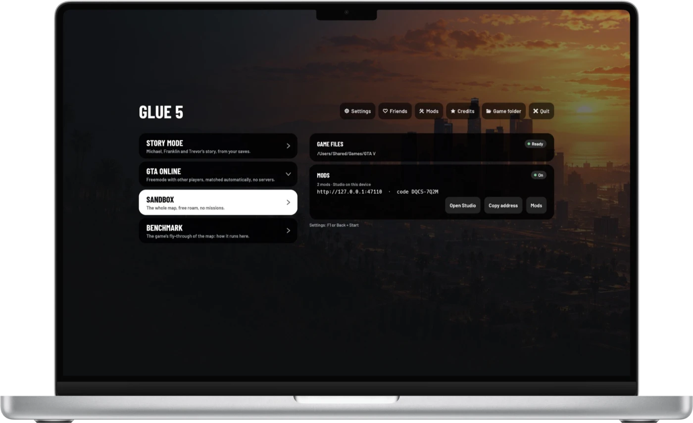

# Playing

  

## The start page

| | |
|---|---|
| **Story mode** | Michael, Franklin and Trevor's story, from your saves. |
| **GTA Online** | Freemode with other players, matched automatically ([more](online.md)). |
| **Sandbox** | The whole map in free roam, no missions. |
| **Benchmark** | The game's fly-through of the map: how it runs on your device, with the last result kept. |

Above them: **Settings**, **Friends** (♡), **Mods**, **Credits** and where
the game's files come from (a folder, or a [server](streaming.md)). The
mode you played last comes first.

## Controls

**Keyboard and mouse** work as on PC. Click into the game to capture the
pointer; Esc releases it.

**Controllers**: Xbox, PlayStation, Nintendo and MFi controllers, with the
game's own button prompts for the one you hold.

**Touch**: an on-screen controller appears on touch screens and hides as
soon as you use a controller or a keyboard. Its buttons follow what you
are doing: on foot, in a car, aiming, under a parachute, in the phone. In
the game's menus and map a finger works as the mouse, and the game's text
boxes bring up the system keyboard.

| | Keyboard | Controller | Touch |
|---|---|---|---|
| The game's menu | Esc | Start | ☰ |
| GLUE 5's settings | F1 | hold Back + Start | ⚙ |
| Friends | Home | hold Back + RB | ♡ on the start page |
| Mods' menus | F7 | | the button next to ⚙ (when a mod has a menu); or [from a phone](mods.md#the-control-page) |
| [Glue Trainer](mods.md#glue-trainer) (mods on) | F4 | in the mods' menus | in the mods' menus |

In GLUE 5's pages, move with the D-pad or the arrow keys, select with A or
Enter, go back with B or Esc.

## Settings

| Tab | Setting | What it does |
|---|---|---|
| Video | **Resolution** | The game's resolution as a share of the screen's; the rest is upscaled. |
| | **Upscaling** | Bicubic, MetalFX (Apple), MetalFX Temporal (Apple) or FSR 2. Temporal upscalers look sharper and cost more. |
| | **Frame generation** | With MetalFX Temporal, where the system offers it: a generated frame between each two. |
| | **Frame rate** | Display (or Unlimited without VSync), 60, 40 (120 Hz screens) or 30. On Apple devices each frame is shown for the same time. |
| | **VSync** | Waits for the display: no tearing. |
| | **Performance overlay** | Frame times, CPU and GPU time, memory; Metal HUD on Apple devices. |
| | **GPU driver** | Android phones with a Snapdragon (Adreno GPU): the phone's own driver, or one added with **GPU drivers › Add…** — an Adreno Tools package (`.zip`), such as Mesa's Turnip or a newer Qualcomm build, the kind emulators use. It applies from the next launch. |
| Controls | **Touch controls** | Auto, On or Off; their size, opacity and camera speed. |
| | **Aim assist** | Lock-on, Snap, Slow-down or Off, for touch aiming. |
| | **Haptics** | The controller's rumble on the phone, while playing by touch. |
| Game | **Game files** | A folder on this device, or a computer that shares them. |
| | **Low memory** | Smaller memory pools and lighter graphics, for devices under 8 GB. |
| | **Friends, mods** | Turn them on or off; friends' notifications. |

Graphics quality (textures, shadows, grass, effects) is set in the game's own
menu: **Settings › Graphics** and **Advanced Graphics**. A change that needs
a restart ends the game; on a computer the app starts again into it, on a
phone you open the app again.

## Performance

What the game's benchmark averaged (default settings; Benchmark on the
start page runs it on your device):

| Device | Benchmark |
|---|---|
| iPhone 16 Pro | ~42 fps |
| iPhone 13 Pro | ~33 fps |
| Pixel 8a | ~30 fps |
| MacBook Pro, M1 Pro (1280×720) | ~160 fps |

To make it smoother:

- **Lower the resolution** and let the upscaler fill the screen: MetalFX
  is the cheapest on Apple devices.
- **Grass Quality Normal** (Settings › Graphics): in the game's benchmark
  on a Mac, Normal ran about 15 % faster than High, and a third faster in
  one of its scenes.
  The low-memory profile sets it to Normal.
- **Cap the frame rate** at 30 (or 40 on a 120 Hz screen): an even 30 looks
  smoother than a rate that jumps between 30 and 60, and keeps the phone
  cooler.
- **Phones get hot.** After a few minutes of play a phone slows its
  processor down to cool off, and the game slows with it. A case off and
  a cool room help.
- **Low memory** keeps devices with less memory from being closed by the
  system.

## Troubleshooting

| Problem | What to do |
|---|---|
| The start page says the files are missing | It says what is missing and where it looks. Copy the whole `game` folder: `data` and `b/…/shaders`. |
| The first Play takes minutes | The app prepares the game's graphics pipelines once; later starts take about a second. |
| The app closes itself on a phone | The system ran out of memory: turn on **Low memory** in Settings › Game. |
| iPhone: the app does not open after a week | With a free Apple ID, install it again every 7 days. |
| Stutter after a while on a phone | The phone is hot: see [Performance](#performance). |
| Android: worse with an added GPU driver | Choose **Phone's** in Settings › Video › GPU driver and open the app again. If a driver stops the app before its start page, the next launch goes back to the phone's driver by itself. |
| Something else | The engine's log is `game.log` in the [user folder](getting-started.md#where-your-data-is). |
